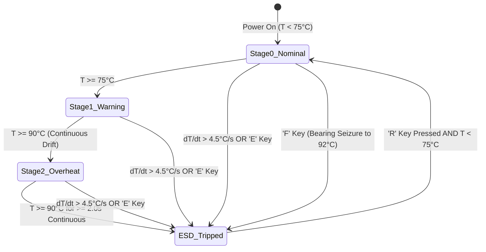

# Industrial Manufacturing Facility: Cyber-Physical Safety Interlock & SCADA Simulation

[](https://cyberbotics.com/)
[](https://www.python.org/)
[](#safety-integrity--regulatory-compliance)
[](#automated-verification-test-suite)

A high-fidelity industrial manufacturing facility simulation built for the **Webots** robotics platform. Designed to replicate modern Safety Instrumented Systems (SIS), SCADA supervisory interlocks, and OSHA Lockout/Tagout (LOTO) protocols, this simulation features a heavy-duty conveyor powertrain, a 3-phase induction drive motor, active forced-air cooling ducts, a 3-tier Andon beacon tower, an in-viewport SCADA HUD, and an automated thermal degradation pipeline.

---

## Table of Contents
1. [Industrial Facility Architecture](#industrial-facility-architecture)
2. [Subsystem Breakdown](#subsystem-breakdown)
3. [Automated Thermal Degradation Pipeline](#automated-thermal-degradation-pipeline)
4. [Safety Integrity & Regulatory Compliance](#safety-integrity--regulatory-compliance)
5. [Project Structure](#project-structure)
6. [Quickstart & Execution Instructions](#quickstart--execution-instructions)
7. [Operator Keyboard Overrides & Fault Injection](#operator-keyboard-overrides--fault-injection)
8. [Automated Verification Test Suite](#automated-verification-test-suite)
9. [In-Viewport SCADA HUD & Telemetry](#in-viewport-scada-hud--telemetry)

---

## Industrial Facility Architecture

The 3D environment models a realistic industrial manufacturing cell:

```
                      +-------------------------------------------------+
                      |     Automated Thermal Degradation Pipeline      |
                      |   Rise: +0.42°C/s | Fan Cooling: -0.18°C/s      |
                      |   Load Friction Degradation: 75°C -> 90°C       |
                      +------------------------+------------------------+
                                               |
                                               v
   +--------------------+           +---------------------+           +--------------------+
   |   Operator Input   | --------> |   ESD Supervisor    | --------> | Physical Actuators |
   | [E] Manual E-Stop  |           | Controller (Python) |           | 'rotational motor' |
   | [R] LOTO Reset     |           |   - Rate-of-Rise    |           | 'fan motor'        |
   | [P] Toggle Pred.   |           |   - Auto Sequencing |           +--------------------+
   | [S] Spike (+0.35C) |           |   - Safety Latching |                     |
   | [F] Seizure Fault  |           |   - Pred. Mode Latch|                     v
   | [H] Surge Shock    |           +----------+----------+           +--------------------+
   +--------------------+                      |                      | Visual SCADA Tower |
                                               v                      |   - Green LED      |
                                    +---------------------+           |   - Amber LED      |
                                    | In-Viewport 2D HUD  |           |   - Red LED Strobe |
                                    | Display Device API  |           +--------------------+
                                    +---------------------+
```

---

## Subsystem Breakdown

### 1. Elevated Industrial Steel Conveyor System
- **Structural Frame**: Tubular structural steel legs with heavy floor anchor footplates, longitudinal extruded C-channel side frames, and cross-braced supports.
- **Side Guide Rails & Deck**: High-visibility safety-yellow cargo guide rails flanking a textured rubber conveyor slider deck with return idler rollers.
- **Factory Cargo**: Realistic manufactured cargo sitting on the live belt line, including a wooden Euro-pallet carrying a heavy machined engine block casting and labeled industrial parts containers.

### 2. Heavy 3-Phase Induction Motor & Coupled Reduction Gearbox
- **Induction Motor Housing**: Heavy cylindrical cast-iron stator with 12 longitudinal ribbed heat sink cooling fins, cast foot mounts, and an overhead terminal junction box with brass conduit cable gland.
- **Reduction Gearbox**: Industrial cast bevel-helical gearbox housing with oil inspection sight glass and flanged output drive coupling attached directly to the conveyor head drum roller.
- **High-Visibility Rotating Assembly ('rotational motor')**:
  * **Sharp Mechanical Geometry**: Replaces the smooth cylinder with an industrial notched cog / sprocket wheel, a 6-blade cross-fin impeller, and 4 longitudinal hazard indicator ribs.
  * **High-Contrast Strobe Coloring**: Dark industrial metallic finish (`#24262E`) contrasted with bright safety-yellow index stripes (`#FAD20D`) along the spokes, outer cog teeth, and roller drum. Creates an unmistakable dynamic strobe effect at full speed (`5.0 rad/s`) and throttled speed (`2.5 rad/s`) from any camera perspective.
  * **Balanced Dynamics**: Symmetrically balanced geometry on the X-axis (`axis 1 0 0`, `anchor -0.28 0 0`) with smooth cylindrical boundingObject to eliminate physics jitter or axis tilt.

### 3. Auxiliary Forced-Air Cooling Duct
- **Cooling Cowl**: Aerodynamic pressed-steel fan cowl shroud with rear protective safety wire mesh intake attached to the non-drive end (NDE) of the motor casing.
- **Internal Axial Fan**: High-velocity 6-blade aerodynamic axial fan in safety-cyan, exposed as `"fan motor"`.
- **Fault-Tolerant Abstraction**: If `"fan motor"` is undeclared or physically omitted in hardware-tolerance tests, the supervisor falls back to virtualized convective dissipation without throwing exceptions.

### 4. 3-Tier Visual SCADA Beacon Tower (Andon Stack Light)
- Positioned on a steel stanchion pole directly beside the drive assembly:
  - **`green_led`** (Bottom Tier): Illuminates solid green during Stage 0 Nominal Operation.
  - **`amber_led`** (Middle Tier): Illuminates solid amber during Stage 1 Active Warning & Derating.
  - **`red_led`** (Top Tier): Pulses during Stage 2 Overheat warning and flashes continuously at 3 Hz upon Emergency Shutdown / OSHA LOTO lock.

### 5. In-Viewport SCADA HUD (Webots Display API)
- An on-screen SCADA telemetry overlay rendered on the Webots 3D view:
  - Live color-coded temperature gauge bar (Green `< 75°C`, Amber `75°C - 90°C`, Red `≥ 90°C`).
  - Real-time operating mode badge: `[NORMAL]`, `[THROTTLED]`, or `[OSHA LOTO LOCKED]`.
  - Predictive Mode status indicator: `Predictive Mode: [ON]` (in cyan `#38BDF8`) or `Predictive Mode: [OFF]` (in gray `#94A3B8`).
  - Drive velocity, cooling fan RPM, $\Delta T / \Delta t$ Rate-of-Rise readout, and controls ribbon: `[E] E-Stop | [R] Reset | [P] Toggle Predictive | [S] Spike | [F] Seizure`.

---

## Automated Thermal Degradation Pipeline

The supervisor eliminates the thermal equilibrium trap at 75°C, ensuring a natural, steady progression from normal run through warning triage into automatic trip:



### Operational Stage Matrix

| Stage | Temperature Range | Main Motor Velocity | Fan Motor Velocity | Andon Light Status | Thermal Dynamics | Behavioral Outcome |
|---|---|---|---|---|---|---|
| **Stage 0: Nominal** | $T < 75.0^\circ\text{C}$ | `5.0 rad/s` (100%) | `0.0 rad/s` (OFF) | **Green ON**, Amber OFF, Red OFF | Rise Rate: $+0.42^\circ\text{C/s}$ | Conveyor rolls forward at full speed. |
| **Stage 1: Warning & Derating** | $75.0^\circ\text{C} \le T < 90.0^\circ\text{C}$ | `2.5 rad/s` (50% VFD derate) | `15.0 rad/s` (Rapid rotation) | Green OFF, **Amber ON**, Red OFF | Heat input cut 40% ($0.252^\circ\text{C/s}$), fan cools at $-0.18^\circ\text{C/s}$. Thermal degradation adds friction (+0.072 to +0.22°C/s). | Fan mitigates heat but does not freeze. Temperature steadily climbs through 80°C and 85°C to 90°C. |
| **Stage 2: Overheat Countdown** | $T \ge 90.0^\circ\text{C}$ | `2.5 rad/s` (Throttled) | `15.0 rad/s` (MAX) | Green OFF, Amber OFF, **Red Pulsing** | Continuous Overheat Timer running | 2.0-second countdown initiates. If sustained for $\ge 2.0\text{ s}$, triggers auto ESD trip. |
| **ESD Tripped: OSHA LOTO** | Latched | `0.0 rad/s` (HARD CUT) | `15.0 rad/s` (Remediation) | Green OFF, Amber OFF, **Red Flashing** | Heat generation is 0.0. Fan actively cools plant. | Hard safety latch engaged. Motor remains completely dead even after cooling below 75°C. |

### Advanced Predictive Rate-of-Rise Analytics & Presentation Mode Toggle
$$\frac{\Delta T}{\Delta t} = \frac{T_k - T_{k-1}}{\Delta t}$$
- **First-Tick Initialization & Warm-Up Phase**: `prev_temp = current_temp` is strictly enforced upon initialization. A 5-tick warm-up phase bypasses the $\Delta T / \Delta t$ trip check, preventing startup artifacts or premature lockout at ambient temperatures (e.g., 26.0°C).
- **Normal Smooth Temperature Rise**: During normal motor operation at full speed (`5.0 rad/s`), temperature rises steadily and smoothly at $+0.10^\circ\text{C}$ to $+0.15^\circ\text{C}$ per second. $\Delta T / \Delta t$ remains at approximately $+0.10$ to $+0.20^\circ\text{C/s}$ (well below the $4.50^\circ\text{C/s}$ limit), ensuring uninhibited conveyor operation.
- **Presentation Mode Toggle ('P' Key)**:
  * Defaults to `OFF` (`predictive_mode_enabled = False`). When `OFF`, $\Delta T / \Delta t > 4.5^\circ\text{C/s}$ trip checks are bypassed, allowing smooth natural thermal progression across Stage 0 (Green) -> Stage 1 (Yellow) -> Stage 2 (Red).
  * Pressing `'P'` toggles Predictive Surge Testing Mode `ON` or `OFF`.
- **Dynamic Spike Trigger & Fault Key ('S' Key)**:
  * Pressing `'S'` introduces an instantaneous single-tick thermal jump of $+0.35^\circ\text{C}$ ($dt = 0.064\text{ s}$), producing $\Delta T / \Delta t = \frac{0.35}{0.064} \approx 5.47^\circ\text{C/s} > 4.50^\circ\text{C/s}$.
  * If `predictive_mode_enabled == True`, this spike immediately triggers the predictive shutdown:
    - Sets `system_locked = True` and latches `trip_reason = "PREDICTIVE ANOMALY: dT/dt EXCEEDED 4.5°C/s"`.
    - Cuts the main drive motor to `0.0 rad/s` instantly.
    - Updates the in-viewport SCADA HUD to show `[OSHA LOTO LOCKED]` with peak $\Delta T / \Delta t$.
  * If `predictive_mode_enabled == False`, the spike is injected but the trip condition is bypassed.

---

## Safety Integrity & Regulatory Compliance

- **OSHA 29 CFR 1910.147 (Lockout/Tagout - LOTO)**:
  - Once locked, `system_locked = True` holds the drive velocity strictly at `0.0 rad/s`.
  - **Conditional Supervisor Reset Check ('R' Key)**:
    * If $T \ge 75.0^\circ\text{C}$: Reset is **strictly rejected**. The motor is held at `0.0 rad/s`, `system_locked` remains `True`, and the following safety diagnostic is logged:
      `[RESET REJECTED - THERMAL HAZARD] Cannot clear LOTO! Motor temperature (XX.X°C) exceeds safe restart threshold (75.0°C). Active cooling in progress...`
    * If $T < 75.0^\circ\text{C}$: Reset is **accepted**. Lockout is cleared (`system_locked = False`), timers are reset, and normal drive velocity (`5.0 rad/s`) is restored.
- **IEC 61508 / 61511 (SIL-2/3 Industrial Safety Instrumented Systems)**:
  - Redundant trip vectors: deterministic sustained thermal ceiling + derivative predictive shock protection + stochastic friction surge detection + hardware manual override.

---

## Project Structure

```
Webots_SCADA_ESD/
├── controllers/
│   └── esd_supervisor_controller/
│       └── esd_supervisor_controller.py   # Primary Python Webots Supervisor Controller
├── worlds/
│   ├── safety_interlock_world.wbt         # High-Fidelity 3D Industrial Manufacturing Cell
│   └── safety_interlock_no_fan.wbt        # Fault-Tolerance Validation World (No Fan Motor)
└── README.md                              # Comprehensive Engineering Manual
```

---

## Quickstart & Execution Instructions

### Method 1: Running in Webots 3D Simulation (GUI)
1. Launch **Webots**.
2. Select **File -> Open World...** (`Ctrl+O`) and load `worlds/safety_interlock_world.wbt`.
3. Click **Play** on the simulation toolbar.
4. Click inside the **3D Viewport** to direct keyboard controls.
5. Watch the conveyor roll forward, observe the Andon beacon tower transition from Green to Amber, observe the fan blades accelerate to 15 rad/s, and track live telemetry on the in-viewport SCADA HUD.

### Method 2: Testing Missing Hardware Fault Tolerance
1. Open `worlds/safety_interlock_no_fan.wbt`.
2. Notice the supervisor controller gracefully identifies the absent `'fan motor'` device:
   ```
   [HARDWARE] Primary Actuator 'rotational motor' ONLINE [Velocity Control].
   [HARDWARE TOLERANCE] 'fan motor' device not physically declared.
                        Operating in hardware-abstracted convective cooling mode.
   ```
3. The simulation continues uninterrupted with simulated convective triage.

### Method 3: Running the Automated Verification Test Suite (Headless)
Run all 10 unit and integration tests from PowerShell/Terminal without opening the GUI:
```powershell
python controllers/esd_supervisor_controller/esd_supervisor_controller.py --test
```

### Method 4: Interactive CLI Standalone Demonstration
To run a standalone live loop in PowerShell/Terminal without Webots:
```powershell
python controllers/esd_supervisor_controller/esd_supervisor_controller.py --standalone
```

---

## Operator Keyboard Overrides & Fault Injection

While the simulation is running with focus on the 3D window:

| Key | Action | Engineering Purpose |
|:---:|---|---|
| **`P`** | **Toggle Predictive Surge Mode** | Toggles Predictive Testing Mode (`ON`/`OFF`). When `OFF`, normal thermal progression occurs; when `ON`, anomalies $\Delta T / \Delta t > 4.5^\circ\text{C/s}$ trip immediate ESD. |
| **`S`** | **Instantaneous Spike Injection** | Injects an acute $+0.35^\circ\text{C}$ single-tick thermal jump ($\Delta T / \Delta t \approx 5.5^\circ\text{C/s}$). Trips ESD immediately if Predictive Mode is `ON`; bypassed if `OFF`. |
| **`F`** | **Fault Injection: Bearing Seizure** | Injects an acute surge jumping temperature directly to **$92.0^\circ\text{C}$** to immediately trigger the automatic emergency shutdown countdown. |
| **`E`** | **Manual Emergency Kill-Switch** | Immediately trips the safety latch, cuts the motor to `0.0 rad/s`, and engages OSHA LOTO. |
| **`R`** | **Supervisor OSHA LOTO Reset** | Checks core temperature: rejects reset with warning if $T \ge 75.0^\circ\text{C}$; clears lockout and restores Stage 0 nominal run if $T < 75.0^\circ\text{C}$. |
| **`H`** | **Rate-of-Rise Surge Injection** | Injects an acute $+8.0^\circ\text{C/s}$ disturbance pulse into thermal flux. |
| **`C`** | **Cryogenic Pulse** | Manually cools core temperature by $-10.0^\circ\text{C}$ to test cooldown release. |

---

## Automated Verification Test Suite

The test suite validates 10 comprehensive cyber-physical safety conditions:

```powershell
python controllers/esd_supervisor_controller/esd_supervisor_controller.py --test
```

```
======================================================================
  STARTING AUTOMATED UPGRADE VERIFICATION SUITE                       
======================================================================
[TEST 1/10] Stage 0 Nominal Operation (Temp < 75.0°C)... PASSED
[TEST 2/10] Stage 1 Active Warning & Derating (75.0°C <= Temp < 90.0°C)... PASSED
[TEST 3/10] Automated Thermal Degradation Progression (75°C -> 90°C without freeze)... PASSED
[TEST 4/10] Stage 2 Sustained Overheat Countdown & Automatic Trip... PASSED
[TEST 5/10] Advanced Predictive Analytics Rate-of-Rise Trip (> 4.5°C/s)... PASSED
[TEST 6/10] Fault Injection: Bearing Seizure ('F' Key)... PASSED
[TEST 7/10] Conditional Supervisor Reset Check ('R' Key Rejection & Clearance)... PASSED
[TEST 8/10] Presentation Mode Toggle ('P') & Dynamic Spike ('S')... PASSED
[TEST 9/10] Hardware Tolerance: Missing Fan & Peripherals... PASSED
[TEST 10/10] In-Viewport SCADA HUD Display Rendering... PASSED
======================================================================
  ALL 10/10 AUTOMATED UPGRADE VERIFICATION TESTS PASSED SUCCESSFULLY! 
======================================================================
```

---

## In-Viewport SCADA HUD & Telemetry

### Telemetry Stream
```
[00:00.00] [STAGE 0: NOMINAL (GREEN)] Temp:  26.0°C | dT/dt: +0.12°C/s | Drive: 5.0 rad/s | Fan:  0.0 rad/s | Pred: OFF | Andon: GREEN | Overheat: 0.00s | LOTO: CLEAR
[00:05.12] [STAGE 0: NOMINAL (GREEN)] Temp:  26.6°C | dT/dt: +0.12°C/s | Drive: 5.0 rad/s | Fan:  0.0 rad/s | Pred: OFF | Andon: GREEN | Overheat: 0.00s | LOTO: CLEAR
[00:10.24] [STAGE 0: NOMINAL (GREEN)] Temp:  27.3°C | dT/dt: +0.12°C/s | Drive: 5.0 rad/s | Fan:  0.0 rad/s | Pred: ON  | Andon: GREEN | Overheat: 0.00s | LOTO: CLEAR
[00:14.53] [ESD TRIPPED: OSHA LOTO] Temp:  28.2°C | dT/dt: +5.59°C/s | Drive: 0.0 rad/s | Fan: 15.0 rad/s | Pred: ON  | Andon: RED STROBE | Overheat: 0.00s | LOTO: LOCKED
```

### Emergency Trip Diagnostic Banner (Predictive Anomaly)
```
======================================================================
  CRITICAL SAFETY TRIP: EMERGENCY SHUTDOWN (ESD) INTERLOCK ENGAGED   
======================================================================
  Sim Timestamp           : 14.528 s (Sim Time) | 2026-10-28 23:39:28
  Primary Trip Trigger    : PREDICTIVE ANOMALY: dT/dt EXCEEDED 4.5°C/s
  Core Temperature        : 28.17 °C (Ceiling Limit: 90.0 °C)
  Peak Temperature Seen   : 28.17 °C
  Thermal Rate-of-Rise    : +5.59 °C/s (Predictive Ceiling: 4.50 °C/s)
  Sustained Overheat Dur  : 0.00 s (Continuous Limit: 2.0 s)
  Main Drive Motor        : HARD CUT / 0.0 rad/s (CONVEYOR HALTED INSTANTLY)
  Auxiliary Cooling Fan   : ACTIVE (15.0 rad/s - Convective Remediation)
  Andon Beacon Status     : RED LED FLASHING (EMERGENCY ALARM ACTIVE)
  Safety Latch State      : HARD OSHA LOTO LOCKOUT ENGAGED 
  OSHA Standard Ref       : 29 CFR 1910.147 Control of Hazardous Energy (LOTO)
  Supervisor Action Req   : 1. Allow convective cooling until Temp < 75.0 °C
                            2. Verify mechanical conveyor clearance & motor integrity
                            3. Press supervisor reset key ['R']
======================================================================
```
```
